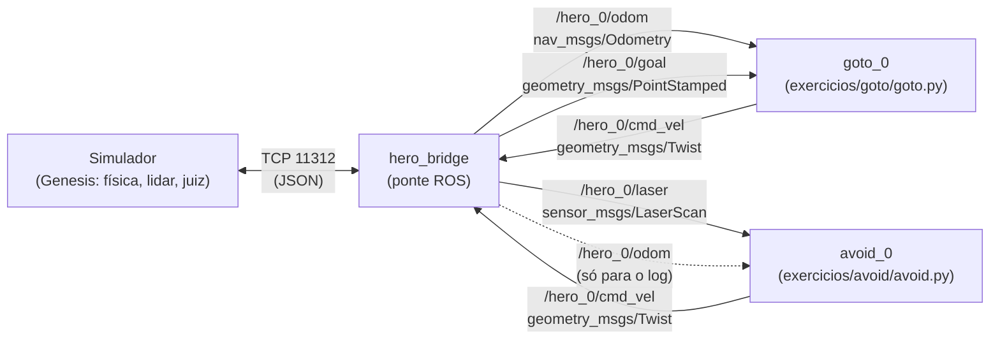
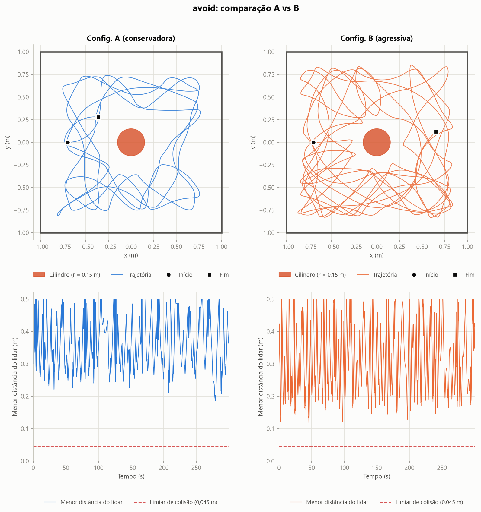
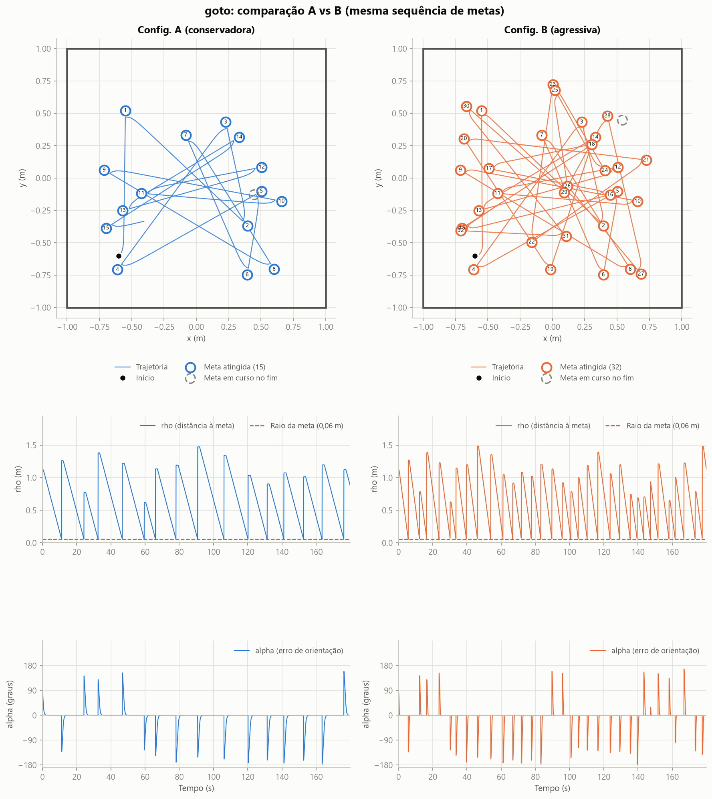

# Relatório 5: ROS e navegação com o HeRo (RASCUNHO)

Projeto de Sistemas Robóticos, DCC/UFMG, 2º semestre de 2026. Prof. Paulo Rezeck.
Equipe: [PREENCHER: nomes e matrículas]. Repositório: [PREENCHER: link]. Entrega: [PREENCHER: confirmar a data, o PDF do enunciado diz 17/11/2026].

> **Como ler este rascunho.** Todos os números das seções de resultados vêm dos CSVs dos ensaios finais
> (`exercicios/*/*_log_*.csv`) e das tabelas em `analise/tabelas/`. Cada configuração foi rodada **três vezes**
> no simulador, em modo CPU. As tabelas mostram **média ± desvio-padrão amostral (n = 3)**; as figuras mostram a
> execução 1. O que não foi medido está marcado com `[PREENCHER]` ou descrito como hipótese.

---

## 1. Introdução

Este trabalho implementa dois comportamentos para o robô HeRo em ROS 1 (Noetic), avaliados no simulador do kit
`psr-hero-kit`: **desvio de obstáculos** (`avoid`) e **navegação até metas** (`goto`). Os dois usam um único
robô e os mesmos tópicos do HeRo real, então o código serve de base para o robô físico.

- **avoid:** manter o robô andando numa arena de 2,0 × 2,0 m com um cilindro de raio 0,15 m no centro, sem
  bater e sem ficar preso, usando **apenas o lidar** de 8 feixes. A odometria só pode ser usada para registrar
  a trajetória.
- **goto:** levar o robô até a meta publicada pelo simulador e, quando ele chega a menos de 6 cm, seguir para a
  próxima meta sorteada, o maior número de vezes possível, usando a odometria.

Para cada exercício foram feitos ensaios com duas configurações de parâmetros (A e B) e comparados com métricas
extraídas dos registros (Seções 4 e 5).

## 2. Nós e tópicos

### 2.1 Diagrama

Os dois nós rodam em ensaios separados (cada um tem seu `launch`), cada um conectado à ponte `hero_bridge`, que
fala com o simulador por TCP.



### 2.2 Tópicos usados

| Tópico | Tipo | Sentido | Usado por |
|---|---|---|---|
| `/hero_0/cmd_vel` | `geometry_msgs/Twist` | publicado | goto, avoid (`linear.x` em m/s, `angular.z` em rad/s) |
| `/hero_0/odom` | `nav_msgs/Odometry` | assinado | goto (controle), avoid (**só log**) |
| `/hero_0/goal` | `geometry_msgs/PointStamped` | assinado | goto |
| `/hero_0/laser` | `sensor_msgs/LaserScan` | assinado | avoid (controle) |

Características do kit relevantes para o controle: tópicos do simulador a 25 Hz; limites do robô
`|v| ≤ 0,2 m/s` e `|w| ≤ 4 rad/s` (acima disso o simulador satura); sem comando por 0,5 s o robô para; lidar de
8 feixes com alcance de 0,037 a 0,5 m, em que o feixe `k` aponta para `−π + k·π/4` (o feixe 4 olha para a frente).
O laço de controle dos dois nós roda a 20 Hz (passo médio medido nos logs: 0,050 s).

### 2.3 Registro dos ensaios

Os nós gravam CSV na pasta do script e param sozinhos (180 s no goto, 300 s no avoid):

- `goto_log_<A|B>.csv`: `t, x, y, theta, xg, yg, rho, alpha, v, w, goal_reached`
- `avoid_log_<A|B>.csv`: `t, x, y, theta, min_range, v, w, mode`

No repositório, o arquivo sem sufixo é a execução 1 e `*_s2.csv` e `*_s3.csv` são as repetições.

---

## 3. Metodologia dos ensaios

- **Simulador:** Genesis, backend CPU, dentro de Docker (Docker Desktop + WSL2). Reprodução: `scripts/ensaio.sh`.
- **Duração:** goto 180 s; avoid 300 s.
- **Execuções:** três por configuração e por exercício, 12 ensaios no total.
  - **goto:** sementes 1, 2 e 3 do simulador. Dentro de uma mesma semente, A e B enfrentaram a **mesma sequência de
    metas**; a semente muda a sequência.
  - **avoid:** a semente do simulador **não tem efeito** (arena fixa, sem sorteio). As três execuções diferem
    apenas pelo sorteio do *wander* e do lado em empates, feitos pelo nó, que **não tem semente fixa**. Portanto são
    execuções independentes, e não "sementes".
  - O desvio-padrão com n = 3 é só uma indicação de variabilidade, não um intervalo de confiança. Os valores de cada
    execução estão em `analise/tabelas/*_repeticoes.md`.
- **Colisão (avoid):** cada vez que a menor distância lida pelo lidar cruza para baixo de 0,045 m (contagem por
  evento, não por amostra).
- **Tempo por meta (goto):** tempo entre atingimentos sucessivos, a primeira meta contada desde t = 0.
- Os gráficos e tabelas são gerados por `analise/plot_avoid.py` e `analise/plot_goto.py`.

---

## 4. Desvio de obstáculos (avoid)

### 4.1 Lei de controle

Estratégia: controle reativo no estilo **Braitenberg por feixe**, mais uma camada de recuperação de travamento.
Para o feixe `k` com distância `d_k` (já tratada, ver 4.2):

```
p_k   = clamp((D_INF − d_k) / (D_INF − 0,037), 0, 1)            proximidade do feixe k, em [0, 1]

w_b   = K_W · ( W_DIAG·(p3 − p5) + W_SIDE·(p2 − p6) )          Braitenberg: obstáculo à direita → w > 0 (gira à esquerda)
w     = w_b + turn_dir · W_FRONT · p4                          termo frontal, com o lado travado (ver abaixo)
w    += wander · (1 − max(p2..p6))                              giro aleatório lento, some perto de obstáculos

d_fwd = min(d4, d3·cos45°, d5·cos45°)                          folga à frente (os diagonais são projetados)
v     = V_CRUISE · clamp((d_fwd − D_STOP) / (D_SLOW − D_STOP), 0, 1)
```

Pseudocódigo da camada de decisão (executada a 20 Hz):

```
d ← sanitiza(ranges)
se em fuga e t < fim_da_fuga:                  v ← 0, w ← sentido_da_fuga · W_ESCAPE
senão:
    se d_fwd < D_BLOCK:
        se bloqueado há ≥ T_BLOCK:             inicia fuga: sentido aleatório por T_ESCAPE s
    senão:                                     zera o relógio de bloqueio
    se d_fwd ≥ D_SLOW:                         turn_dir ← 0              (frente livre: solta o lado)
    senão se turn_dir = 0 e p4 > 0:            turn_dir ← +1 se (d5+d6) > (d3+d2) senão −1
                                               (aleatório se a diferença < 2 cm)
    calcula w e v pelas equações acima; satura em W_MAX e V_MAX
```

**Por que esta estratégia.** Tem poucos parâmetros com significado físico (distância em que começa a reagir,
quanto gira, velocidade), o que permite explicar a diferença entre as configurações. O ponto fraco do Braitenberg
puro, um obstáculo exatamente à frente (`w ≈ 0`), é tratado pelo lado de giro travado (`turn_dir`), que evita
oscilar entre esquerda e direita. O *wander* foi acrescentado depois de um teste curto no simulador mostrar que a
config B caía numa órbita periódica (Seção 4.5).

### 4.2 Tratamento das leituras do lidar

- `nan` ou valor `≤ 0`: reaproveita o último valor válido daquele feixe (0,5 m se ainda não houve nenhum).
- `inf` ou valor `> 0,5`: vira 0,5 m (nada à vista).
- valor `< 0,037`: vira 0,037 m (alcance mínimo).
- lista com menos de 8 valores: os feixes que faltam são tratados como `nan`.

Coberto por testes offline (`tests/test_avoid.py`). **Observação:** o simulador sempre entrega valores válidos em
[0,037; 0,5]. Esse tratamento nunca foi acionado nos ensaios, só nos testes.

### 4.3 Parâmetros

| Parâmetro | Significado | A | B |
|---|---|---|---|
| `V_CRUISE` (m/s) | velocidade de cruzeiro | 0,10 | 0,20 |
| `K_W` | ganho do termo de Braitenberg | 4,0 | 8,0 |
| `W_DIAG`, `W_SIDE` | pesos dos feixes diagonais (3, 5) e laterais (2, 6) | 1,0 / 0,5 | 1,0 / 0,5 |
| `W_FRONT` (rad/s) | giro quando há algo de frente | 2,5 | 4,0 |
| `D_INF` (m) | distância em que o feixe começa a pesar | 0,35 | 0,25 |
| `D_SLOW` (m) | folga abaixo da qual o robô desacelera | 0,30 | 0,22 |
| `D_STOP` (m) | folga em que a velocidade chega a zero (só gira) | 0,10 | 0,09 |
| `D_BLOCK` (m) | folga abaixo da qual a frente conta como bloqueada | 0,12 | 0,10 |
| `T_BLOCK` (s) | tempo de bloqueio até acionar a fuga | 1,5 | 1,0 |
| `T_ESCAPE` (s), `W_ESCAPE` (rad/s) | duração e velocidade de giro da fuga | 1,0 / 2,5 | 0,8 / 4,0 |
| `W_WANDER` (rad/s) | amplitude do giro aleatório (redefinido a cada 2 a 4 s) | 0,3 | 0,5 |
| `TIE_EPS` (m) | empate esquerda/direita para escolher o lado ao acaso | 0,02 | 0,02 |

A config A é **cautelosa** (lenta, reage cedo, giro suave). A config B é **rápida** (velocidade máxima, reage
tarde, giro forte).

### 4.4 Resultados (ensaios de 300 s, 3 execuções por configuração)

Figuras (execução 1): `analise/figuras/avoid_trajetoria_A.png`, `avoid_trajetoria_B.png`, `avoid_distancia_A.png`,
`avoid_distancia_B.png` e a comparação lado a lado `avoid_comparacao.png`.



Média ± desvio-padrão (n = 3); entre parênteses, os valores das execuções 1, 2 e 3.

| Métrica | A | B |
|---|---|---|
| Duração (s) | 300 | 300 |
| Distância percorrida (m) | 26,98 ± 0,21 (26,92 / 26,81 / 27,21) | 54,37 ± 0,17 (54,44 / 54,18 / 54,50) |
| **Colisões** (menor distância < 0,045 m) | **0, 0, 0** | **0, 0, 0** |
| Menor distância lida pelo lidar (m) | 0,193 ± 0,008 (0,186 / 0,191 / 0,202) | 0,124 ± 0,011 (0,118 / 0,137 / 0,117) |
| Menor distância, percentil 5 (m) | 0,255 ± 0,004 | 0,177 ± 0,004 |
| Velocidade linear média (m/s) | 0,090 ± 0,001 | 0,182 ± 0,001 |
| Tempo em modo de desvio (%) | 39,5 ± 1,5 (37,7 / 40,3 / 40,4) | 25,2 ± 1,8 (25,5 / 26,9 / 23,3) |
| Acionamentos do anti-travamento | 0, 0, 0 | 0, 0, 0 |
| Cobertura da arena (células de 0,25 m, de 64) | 38,7 ± 2,1 (41 / 38 / 37) | 60,3 ± 1,5 (62 / 60 / 59) |

### 4.5 Comparação A vs B

- **Segurança:** nenhuma das 6 execuções colidiu. O menor valor lido em cada configuração, entre as 3 execuções,
  foi 0,186 m na A e 0,117 m na B, cerca de 4,1 e 2,6 vezes o limiar de 0,045 m. A B chega mais perto dos
  obstáculos (média da menor distância 0,124 m contra 0,193 m), como esperado de uma zona de reação mais estreita
  (`D_INF` 0,25 m contra 0,35 m) e de uma velocidade duas vezes maior.
- **Distância e velocidade:** a B percorreu 2,0× a distância da A (54,4 m contra 27,0 m), igual à razão das
  velocidades médias (0,182 contra 0,090 m/s). O desvio-padrão da distância entre execuções é menor que 1% da média.
- **Tempo reagindo:** a A passa mais tempo em modo de desvio (39,5% contra 25,2%), porque sua zona de influência é
  mais larga e ela "sente" os obstáculos mais cedo.
- **Cobertura:** a B visitou 60,3 das 64 células em média (59 a 62), a A 38,7 (37 a 41): as faixas não se
  sobrepõem. Parte da diferença vem simplesmente de a B andar o dobro, e do *wander* maior (0,5 contra 0,3 rad/s). A
  cobertura **não foi normalizada** pela distância. Na execução 1 da A, a cobertura ficou quase parada entre 150 e
  220 s (37 células), subindo só a 41 no fim.
- **Variabilidade entre execuções:** pequena, mas vem do sorteio do *wander* feito pelo nó (Seção 3). Com n = 3
  o desvio-padrão é apenas indicativo.

### 4.6 Caso de falha observado: órbita periódica (antes do *wander*)

Em testes curtos de ~91 s (antes do *wander*, sem semente fixa), a config B visitou 29 células até os 45 s e **não
visitou nenhuma nova até o fim** (29 células aos 45, 60, 75 e 90 s): o robô percorria sempre o mesmo laço, sem
tocar em nada. A config A, nesse mesmo teste, ainda crescia (9 → 27 células de 30 a 90 s). Com o *wander*, a B
chegou a 48 células em ~91 s e continuou crescendo. Isso não violava o enunciado (não bateu nem travou), mas era
visualmente repetitivo; por isso o *wander* foi incluído. Esses testes curtos foram exploratórios e seus
registros não foram guardados no repositório.

---

## 5. Navegação até metas (goto)

### 5.1 Lei de controle

Com a pose `(x, y, θ)` (yaw obtido do quaternion de `/hero_0/odom`) e a meta `(xg, yg)` de `/hero_0/goal`:

```
ρ     = √((xg − x)² + (yg − y)²)
α     = wrap( atan2(yg − y, xg − x) − θ )                      normalizado para [−π, π)

w     = Kα · α
v     = Kρ · ρ · max(cos α, 0)        se |α| ≤ α_stop
v     = 0                             se |α| > α_stop          (gira no lugar até alinhar)

v ← clamp(v, 0, v_max)      w ← clamp(w, −w_max, w_max)
se ρ < 5 mm:  v = w = 0                                         (zona morta: o ângulo perde o sentido)
```

A troca de meta é detectada quando `/hero_0/goal` muda (o simulador só sorteia nova meta quando a atual é atingida),
e a primeira linha do log com a nova meta recebe `goal_reached = 1`. O robô **não para** na meta: passa por ela com
velocidade, o que basta porque o simulador testa a distância a cada passo.

### 5.2 Ganhos e limites

| Parâmetro | A (conservadora) | B (agressiva) |
|---|---|---|
| `Kρ` | 1,0 | 2,0 |
| `Kα` | 2,0 | 4,0 |
| `v_max` (m/s) | 0,10 | 0,20 |
| `w_max` (rad/s) | 2,0 | 4,0 |
| `α_stop` | 60° | 100° |

Limites físicos do kit: `V_MAX = 0,2 m/s` e `W_MAX = 4 rad/s`. A B opera nesses limites; a A usa metade da
velocidade linear e da angular.

### 5.3 Resultados (ensaios de 180 s, sementes 1, 2 e 3)

Figuras (semente 1): `analise/figuras/goto_trajetoria_A.png`, `goto_trajetoria_B.png`, `goto_rho_alpha_A.png`,
`goto_rho_alpha_B.png` e a comparação `goto_comparacao.png`.



Média ± desvio-padrão (n = 3); entre parênteses, os valores das sementes 1, 2 e 3.

| Métrica | A | B |
|---|---|---|
| Duração (s) | 180 | 180 |
| **Metas atingidas** | **15,7 ± 1,2** (15 / 15 / 17) | **32,3 ± 0,6** (32 / 33 / 32) |
| **Tempo médio por meta (s)** | **11,1 ± 0,9** (11,8 / 11,4 / 10,1) | **5,5 ± 0,1** (5,6 / 5,4 / 5,6) |
| Tempo mediano por meta (s) | 10,9 ± 1,0 (12,0 / 9,9 / 10,9) | 5,3 ± 0,6 (5,7 / 4,6 / 5,7) |
| Distância percorrida (m) | 16,40 ± 0,12 (16,38 / 16,52 / 16,29) | 33,07 ± 0,06 (33,04 / 33,14 / 33,03) |
| Velocidade linear média (m/s) | 0,092 ± 0,001 | 0,185 ± 0,000 |
| `|α|` médio com v > 0,05 m/s (graus) | 2,5 ± 0,3 (2,4 / 2,2 / 2,8) | 3,8 ± 0,1 (3,8 / 3,9 / 3,7) |
| Tempo girando no lugar, v = 0 (%) | 7,5 ± 0,7 (7,9 / 6,7 / 8,0) | 6,6 ± 0,3 (6,8 / 6,3 / 6,6) |
| Trocas de sinal de `w` com ρ < 0,15 m | 0, 0, 0 | 0, 0, 0 |

### 5.4 Comparação A vs B

- **A diferença é dominada pela velocidade.** Em média, a B atingiu 2,1× mais metas (32,3 contra 15,7), com tempo
  médio por meta 2,0× menor e velocidade média 2,0× maior (0,185 contra 0,092 m/s). Em cada uma das 3 sementes a B
  fez de 1,9× a 2,2× as metas da A (32 contra 15, 33 contra 15 e 32 contra 17). A
  distância percorrida por meta é parecida nas duas (16,40 ÷ 15,67 = 1,05 m na A e 33,07 ÷ 32,33 = 1,02 m na B).
- **Giro no lugar:** a fração do tempo girando é parecida (7,5% e 6,6%), mas como cada meta dura menos na B, o tempo
  absoluto de giro por meta cai de cerca de 0,87 s (A) para 0,37 s (B). Esse valor é derivado das médias das
  porcentagens e do número de metas, então vale como estimativa. É compatível com o `w_max` dobrado (4 contra 2 rad/s).
- **Custo do ganho alto:** o erro angular médio ao andar é maior na B (3,8° contra 2,5°). Nas 3 sementes o valor da
  B (3,7 a 3,9°) ficou acima do da A (2,2 a 2,8°). A diferença vem do transitório após cada troca de meta, não do
  trecho em linha reta: separando as amostras com v > 0,05 m/s, a partir de 1,5 s após a troca o `|α|` médio fica
  entre 0,0° e 0,7° nas duas configurações, enquanto nos primeiros 1,5 s fica entre 17° e 32°. Na B esses trechos
  iniciais são cerca de 22% das amostras em movimento, contra 6 a 8% na A, porque as metas duram menos e o
  `α_stop` de 100° deixa o robô avançar enquanto ainda gira. Por isso o erro médio pesa mais na B.
- **Sem oscilação perto da meta** (0 trocas de sinal de `w` com ρ < 0,15 m) nas duas, e nenhuma meta perdida em
  nenhum dos 6 ensaios: a chegada é em linha reta, com `α ≈ 0`. A B, com `Kα = 4` e laço de 20 Hz, não mostrou
  instabilidade no simulador.
- **Efeito visível nos gráficos de `α`:** a cada troca de meta, `α` salta para valores grandes (até ±180°) e
  decai em poucos instantes, o que gera os picos em dente de serra de `ρ` e `α`.
- **Variabilidade:** a A varia mais entre sementes (de 15 a 17 metas) porque o número de metas depende da sequência
  sorteada (metas mais distantes ou atrás do robô custam mais tempo). A B varia menos (32 a 33). Os dados confirmam
  essa explicação: a distância média entre metas consecutivas (16 primeiras metas) é 1,16 m, 1,10 m e 1,03 m nas
  sementes 1, 2 e 3, e a semente 3, com metas mais próximas, é justamente a que deu 17 metas na A.
- **Observação:** em ensaios exploratórios anteriores, sem semente fixa, o resultado foi 18 metas (A) e 35 (B). Esses
  registros não foram guardados e não entram nas tabelas.

---

## 6. Discussão

### 6.1 Limitações das estratégias

**goto**
- Não há tratamento de obstáculos: só funciona em arena livre, como a do exercício.
- O controle é proporcional em `α` e `ρ`, sem integral nem modelo de atraso. Não foi testada a robustez a ruído ou
  atraso na pose.
- O robô passa pela meta sem parar. Isso satisfaz o critério de 6 cm do simulador, mas não serviria para uma
  tarefa que exija parar na meta.
- A cada troca de meta o robô perde tempo girando no lugar quando a nova meta está atrás dele (7,5% do tempo na A e
  6,6% na B, em média).
- Como a diferença A/B é quase toda de `v_max`, o ensaio não isola o efeito de cada ganho separadamente.
  [PREENCHER: se houver tempo, um ensaio variando só `Kα`.]

**avoid**
- Com 8 feixes de 45°, o lidar tem setores cegos entre os feixes. Os feixes saem do centro do robô; no pior caso
  o centro do cilindro fica a 22,5° dos dois feixes vizinhos, e um feixe só o acerta se `D · sin 22,5° ≤ 0,15 m`
  (`D` = distância do robô ao centro do cilindro), ou seja, `D ≤ 0,39 m`: a detecção do cilindro só é
  **garantida a menos de ~0,24 m da sua superfície**. Mais longe que isso ele pode passar entre dois feixes, o que
  cobre parte da zona de reação da A (`D_INF = 0,35 m`) e o limite da B (`D_INF = 0,25 m`). Como a velocidade só
  chega a zero com `D_STOP` = 0,09 a 0,10 m, isso basta para não bater, mas a reação ao cilindro pode começar mais
  tarde do que `D_INF` sugere. Obstáculos mais estreitos teriam uma faixa de detecção garantida ainda menor.
- Não há memória nem mapa: o controle é puramente reativo e pode cair em mínimos locais (cantos) ou órbitas
  periódicas, como visto na B antes do *wander*.
- O robô não dá ré. A única saída de uma situação de bloqueio é girar no lugar.
- O anti-travamento **nunca foi acionado nos ensaios do simulador** (0 acionamentos nas 6 execuções finais, 3 de A e
  3 de B, nem nos testes curtos). Só foi exercitado nos testes offline. Portanto não há evidência no simulador de que ele
  resolva um travamento real, apenas de que o robô não travou sem ele.
- A cobertura da A é limitada pela baixa velocidade. A comparação de cobertura não normaliza pela distância.
- O *wander* é aleatório. A mesma configuração dá trajetórias diferentes entre execuções (o nó aceita o parâmetro
  `~seed`, **não usado** em nenhum ensaio). Isso é a única fonte de variação entre as execuções do avoid; as
  métricas variaram pouco (Seção 4.4).

### 6.2 Casos de falha observados

- **Órbita periódica na B (avoid)**, descrita na Seção 4.6, corrigida com o *wander*.
- **Não observados** nos ensaios finais: colisões, travamentos, metas perdidas ou oscilação perto da meta.
- Problemas de infraestrutura (não do robô): a janela 3D do simulador não abria dentro do Docker Desktop no WSL2
  ("No display detected") até o `run.sh` passar a montar o socket X do WSLg de outro diretório. Também, ao
  terminar o nó, o `roslaunch` continua vivo por causa da ponte, exigindo encerrar o container.

### 6.3 O que mudar para rodar no HeRo real

Nenhum dos pontos abaixo foi medido; são mudanças esperadas e o que cada uma exigiria. [PREENCHER: se a equipe
testar no robô físico, trocar hipóteses por medidas.]

- **Ruído do lidar.** No simulador o lidar é determinístico (o modelo é geométrico, sem ruído). No robô real
  haverá ruído, leituras perdidas e valores fora de faixa. O tratamento de `nan/inf/zero` já existe, mas falta
  filtrar o ruído (por exemplo, mediana de poucas amostras ou suavização exponencial) e revisar `D_BLOCK` e `D_STOP`,
  que hoje assumem leituras exatas. Também convém conferir o mapeamento dos feixes e o desalinhamento angular do
  sensor.
- **Deriva da odometria.** O goto depende da pose, e no simulador a pose publicada vem do estado da física (o código do
  kit descreve "ground-truth state" e não modela ruído nem deriva; conferido em `world.py` e na ponte). No robô, a odometria das rodas deriva (patinação, erro de calibração) e o erro cresce com a distância.
  Seria preciso corrigir a pose com outra fonte (câmera, marcadores, fusão com IMU) ou tolerar o erro com um
  critério de chegada compatível.
- **Latência.** O laço roda a 20 Hz e o robô para após 0,5 s sem comando. Com atraso de rede/ROS e do sensor, o
  ganho `Kα` alto da B pode causar oscilação. Convém medir a latência e reduzir ganhos ou adicionar limitação de
  aceleração.
- **Saturação e zona morta dos motores.** O robô real tem velocidade mínima abaixo da qual os motores não
  movem e pode saturar antes de 0,2 m/s e 4 rad/s. Seria preciso um comando mínimo (compensação de zona morta),
  rampas de aceleração e conferir os limites reais. A zona morta também afeta o giro lento perto do alinhamento.
- **Calibração.** Raio das rodas e distância entre rodas (odometria), ganho de cada motor, e a calibração do lidar
  (posição e orientação no robô). Os parâmetros A e B teriam que ser reajustados para o atrito e a tensão da bateria
  reais.
- **Referencial.** No simulador a pose está num referencial `world` fixo e as metas vêm nesse mesmo referencial. No
  robô, a origem da odometria é a posição de partida; as metas precisariam ser dadas no mesmo referencial.
  [PREENCHER]

---

## 7. Conclusão

Foram implementados e avaliados no simulador dois nós ROS para o HeRo, `goto` e `avoid`, cada um com duas
configurações de parâmetros e avaliado em três execuções por configuração.

- No **goto**, a lei de controle proporcional em `α`, com velocidade reduzida pelo cosseno do erro, atingiu as metas
  sem oscilar nem perder nenhuma. A configuração B atingiu em média 32,3 metas em 180 s contra 15,7 da A (tempo
  médio por meta de 5,5 s contra 11,1 s), diferença explicada principalmente pela velocidade máxima.
- No **avoid**, o controle Braitenberg com anti-travamento e *wander* manteve o robô andando por 300 s sem
  nenhuma colisão nas 6 execuções (menor distância lida de 0,193 m na A e 0,124 m na B em média, contra o limiar de
  0,045 m). A B cobriu mais a arena (60,3 contra 38,7 de 64 células, em média) e andou o dobro da distância.
- Os resultados vêm de **três execuções por configuração** (desvios-padrão pequenos, mas com n = 3 só indicativos),
  com o simulador (física e lidar sem ruído, odometria sem deriva). O anti-travamento não foi exercitado no
  simulador. A transferência para o HeRo real exigirá tratar ruído do lidar, deriva da odometria, latência e as
  não linearidades dos motores.

[PREENCHER: trabalhos futuros que a equipe queira citar, por exemplo ensaio isolando cada ganho, mais execuções
para um intervalo de confiança e testes no robô real.]

---

## 8. Reprodutibilidade

Código, registros, scripts de gráficos e README em [PREENCHER: link do repositório]. Para repetir um ensaio:
`./scripts/ensaio.sh <goto|avoid> <A|B> [semente]`. Para gerar gráficos e tabelas:
`python analise/plot_avoid.py`, `python analise/plot_goto.py` e, para a média e o desvio entre as execuções,
`python analise/repeticoes.py`.

Vídeos: goto [PREENCHER: link], avoid [PREENCHER: link].

---

## Pendências antes de converter para PDF

1. [PREENCHER] nomes e matrículas da equipe, link do repositório, links dos vídeos e a data de entrega (o PDF do
   enunciado diz 17/11/2026).
2. Gravar os vídeos de 1 a 2 min de cada exercício (nenhum foi gravado até agora).
3. ~~Revisar as hipóteses marcadas~~ (feito: `|α|` maior na B e variação da A entre sementes confirmados nos logs;
   argumento dos setores cegos corrigido com a geometria).
4. Converter o Mermaid do item 2.1 em imagem para o PDF (ou desenhar o diagrama na ferramenta preferida).
5. Decidir se as figuras do relatório mostram só a execução 1 ou se vale incluir a dispersão entre as execuções.
